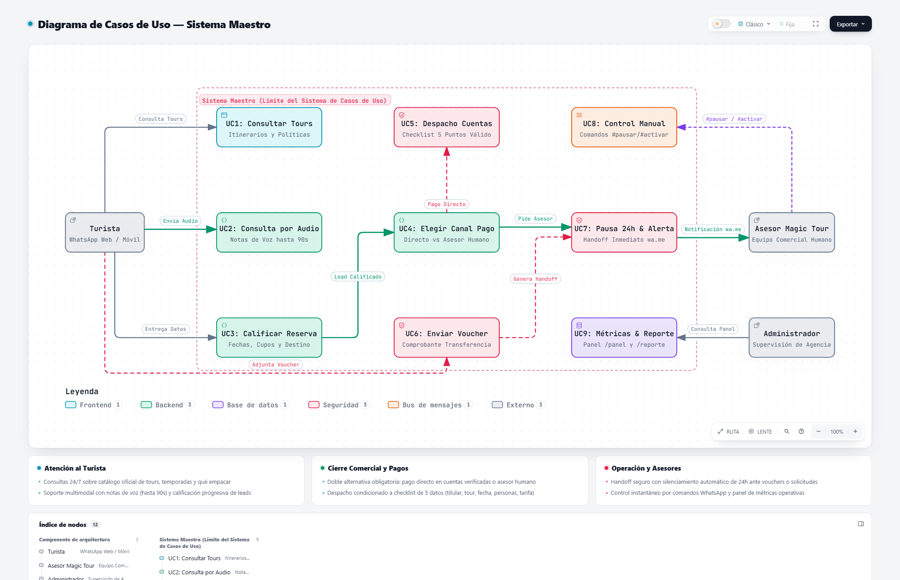
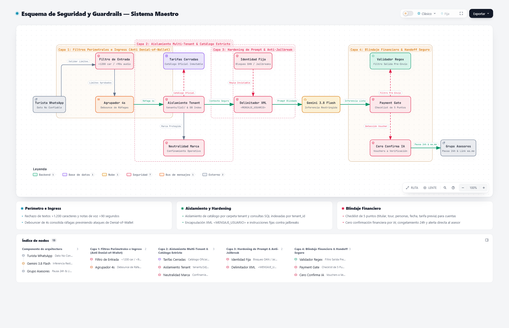
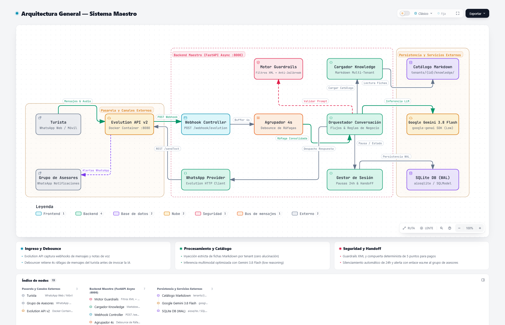
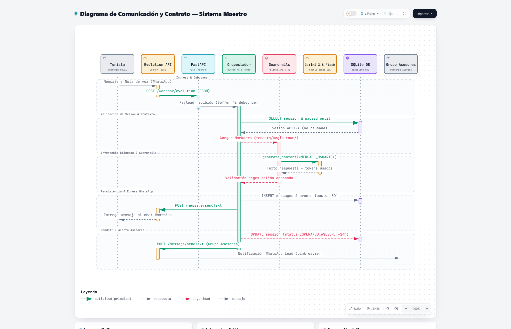

# Maestro

> **Infraestructura de IA Conversacional y Ventas 24/7 en WhatsApp para Agencias y Operadores Turísticos.**  
> *Convierte conversaciones en reservas confirmadas con precisión quirúrgica, cero alucinaciones de precios y blindaje financiero.*

---

## ¿Qué es Maestro?

**Maestro** es un asistente virtual multi-tenant para WhatsApp diseñado específicamente para agencias de viajes receptivas y operadores turísticos. A diferencia de un chatbot genérico o un LLM sin restricciones, Maestro combina la fluidez del lenguaje natural con **compuertas deterministas de negocio**, asegurando que cada cotización, política o dato de pago esté estrictamente anclado al catálogo oficial de la agencia.

Su arquitectura resuelve de raíz los problemas más costosos del sector:
- **Pérdida de turistas extranjeros y nocturnos** que escriben fuera de horario de oficina (6:00 PM – 8:00 AM) o en diferentes zonas horarias.
- **Riesgo reputacional y de caja** por bots que inventan descuentos, confunden temporadas o entregan datos bancarios a usuarios malintencionados.
- **Saturación del equipo comercial** respondiendo repetidamente itinerarios, inclusiones y fechas de cierre de parques.

---

## ¿Para Quién Es?

- **Operadores Turísticos Receptivos:** Agencias que comercializan experiencias de naturaleza, caminatas arqueológicas (ej. *Ciudad Perdida / Teyuna*), parques nacionales (*PNN Tayrona*) o excursiones costeras y fluviales.
- **DMCs y Agencias de Viajes Locales:** Empresas con catálogos dinámicos que necesitan atender a turistas nacionales y extranjeros en **español e inglés** sin contratar turnos rotativos de madrugada.
- **Equipos Comerciales de Turismo:** Asesores que quieren recibir *leads* ya calificados (con destino, cantidad de personas, fechas tentativas y cotización informada) listos para el cierre final.

---

## Casos de Uso y Flujo Comercial

Maestro cubre el ciclo de atención comercial de punta a punta, coordinando la interacción del turista, el motor de inteligencia y el equipo comercial humano:

---

## Características Principales y Atractivo Comercial

### 1. Atención Imparable 24/7 en Español e Inglés
Atiende consultas en tiempo real sin importar la diferencia horaria de los viajeros internacionales, manteniendo siempre el contexto de la conversación y respondiendo con tono cálido, profesional y local.

### 2. Audio Nativo con Transcripción de Voz
Los turistas suelen enviar mensajes de voz en lugar de escribir. Maestro procesa notas de voz de hasta 90 segundos, las transcribe en milisegundos y responde de manera estructurada con la información del catálogo.

### 3. Agrupador de Ráfagas Inteligente (Debouncer 4s)
Cuando un usuario escribe fragmentado (*"Hola"*... *"buenas"*... *"cuánto vale el tour"*), Maestro espera 4 segundos para consolidar la idea y responde en **un solo mensaje ordenado**, evitando saturar el chat y optimizando el consumo de cómputo.

### 4. Inteligencia de Cierres de Parques y Recomendaciones Proactivas
Conoce el calendario oficial de descanso espiritual y ambiental (como las 3 temporadas de `#RespiraTayrona` y el cierre anual de Ciudad Perdida). Si un turista pide fechas bloqueadas, Maestro no dice simplemente "está cerrado": **recomienda proactivamente rutas y tours alternativos** para no perder la venta.

### 5. Blindaje Financiero: Payment Gate Determinista
El bot **nunca envía cuentas bancarias por impulso**. Para desbloquear las cuentas de pago, verifica obligatoriamente un checklist de 5 condiciones:
1. Nombre completo del titular de la reserva.
2. Tour específico del catálogo oficial.
3. Cantidad de personas.
4. Fecha tentativa de salida.
5. Haber informado previamente en el chat la tarifa oficial publicada.

### 6. Cero Confirmación Financiera por IA y Handoff Seguro
Al recibir fotos de comprobantes de transferencia (Bancolombia, Nequi, etc.), Maestro **jamás da por confirmado el dinero por su cuenta**. Pausa el bot automáticamente para ese chat durante 24 horas y envía una alerta de alta prioridad al grupo de WhatsApp de asesores con el resumen del lead y un enlace directo `wa.me` para verificación humana.

### 7. Control Humano Instantáneo (`#pausar` / `#activar`)
Los asesores siempre tienen la última palabra. Si un asesor escribe manualmente desde el WhatsApp del negocio o envía `#pausar`, el bot se silencia. Con `#activar`, el bot retoma el control automáticamente.

---

## Blindaje de Seguridad y Guardrails en 4 Capas

Para garantizar confiabilidad institucional y mitigar riesgos de jailbreak, gaslighting o fuga de información, Maestro implementa una arquitectura de defensa en profundidad:

1. **Capa 1 — Filtros Perimetrales e Ingress (Anti Denial-of-Wallet):**  
   Rechazo estricto de textos mayores a 1.200 caracteres y audios de más de 90 segundos. El Agrupador de 4 segundos consolida ráfagas antes de invocar la IA, protegiendo costos de inferencia.
2. **Capa 2 — Aislamiento Multi-Tenant y Catálogo Estricto:**  
   Inyección contextual basada exclusivamente en fichas Markdown (`tenants/{id}/knowledge/`). La base de datos y la configuración están aisladas por tenant para evitar mezclas de catálogos y proteger la marca.
3. **Capa 3 — Hardening de Prompt y Anti-Jailbreak:**  
   Los mensajes del turista se encapsulan en delimitadores XML `<MENSAJE_USUARIO>`, neutralizando inyecciones de instrucciones. El System Prompt tiene identidad inmutable y secreto operativo absoluto.
4. **Capa 4 — Blindaje Financiero & Handoff Seguro:**  
   Payment Gate determinista con checklist de 5 datos. Válidador regex pre-envío para impedir que el LLM invente precios o rebajas. Cero confirmación autónoma de transferencias bancarias y escalamiento inmediato al equipo humano.

---

## Panel Ejecutivo y Métricas en Tiempo Real

Maestro incluye un motor de métricas comerciales y endpoints protegidos con autenticación:

- **Dashboard Visual (`GET /panel`):** Métricas de embudo comercial (consultas $\rightarrow$ cotizaciones $\rightarrow$ solicitud de cuentas $\rightarrow$ comprobantes $\rightarrow$ handoffs), volumen fuera de horario comercial, ranking de tours más demandados y consumo de IA.
- **Reporte Markdown (`GET /reporte`):** Resumen ejecutivo exportable en formato compatible con WhatsApp para compartir reportes de desempeño al cierre de la semana con un solo clic.

---

## Perfil Técnico y Arquitectura

Maestro está diseñado bajo principios de desacoplamiento, pruebas continuas (TDD) y observabilidad para producción.

### Topología General del Sistema

| Capa | Tecnología / Herramienta | Propósito |
|---|---|---|
| **Lenguaje & Runtime** | Python 3.11+ (FastAPI async) | Alto rendimiento en I/O sin bloqueo de eventos. |
| **Pasarela WhatsApp** | Evolution API v2 (Docker) | Gestión robusta de Webhooks, instancias y multimedia. |
| **Motor de Razonamiento** | Google Gemini 3.8 Flash (`low` reasoning) | Respuestas ágiles, económicas y con alta adherencia a instrucciones. |
| **Persistencia** | SQLite en modo WAL (`aiosqlite`) | Rendimiento de lecturas concurrentes sin complejidad de configuración pesada. |
| **Base de Conocimiento** | Markdown Jerárquico Multi-Tenant | Separación estricta de catálogos (`tenants/{id}/knowledge/`). |
| **Guardrails de Seguridad** | Delimitadores XML + Validador regex | Protección anti-prompt injection, prevención de fugas y bloqueo de descuentos inventados. |
| **Observabilidad** | Logs estructurados JSON (`structlog`) | Trazabilidad por `requestId`, tiempos RED y contabilidad de tokens/costos. |
| **Calidad y Regresión** | Pytest (46 tests) + Suite de Evaluación (42 casos críticos) | 100% de cobertura en compuertas de seguridad, precios exactos y flujos comerciales. |

### Ciclo de Vida E2E y Contrato de Comunicación

Secuencia completa de procesamiento desde el ingreso del mensaje hasta la entrega y alertas al equipo comercial:

---

## ¿Por Dónde Escala? (Estrategia de Crecimiento)

1. **Aislamiento Multi-Tenant Limpio:**  
   Cada nueva agencia se integra como una carpeta independiente (`tenants/nombre-agencia/`) con su propio `config.yaml`, cuentas bancarias y base de tours, permitiendo operar decenas de agencias en una sola instancia sin mezcla de datos.

2. **Scraping y Onboarding Acelerado:**  
   Herramientas integradas para transformar sitios web de agencias turísticas en fichas Markdown estructuradas listas para operar en cuestión de horas.

3. **Integración con Pasarelas de Pago:**  
   Evolución natural hacia links de pago dinámicos (Wompi / Bold / PSE) complementarios al despacho seguro de cuentas tradicionales.

4. **Multi-Canal:**  
   Arquitectura desacoplada en el orquestador (`ConversationOrchestrator`), permitiendo reutilizar el mismo motor de conocimiento para Instagram DMs, webchat o Telegram.

---

*Maestro — Tecnología colombiana de IA aplicada para impulsar el turismo sostenible y multiplicar las ventas de tu agencia.*
